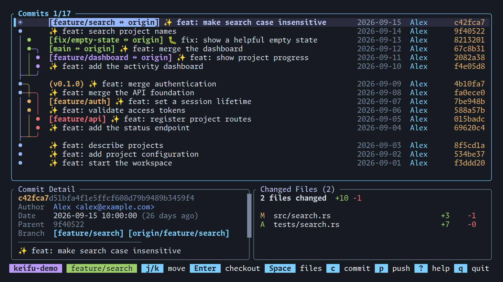
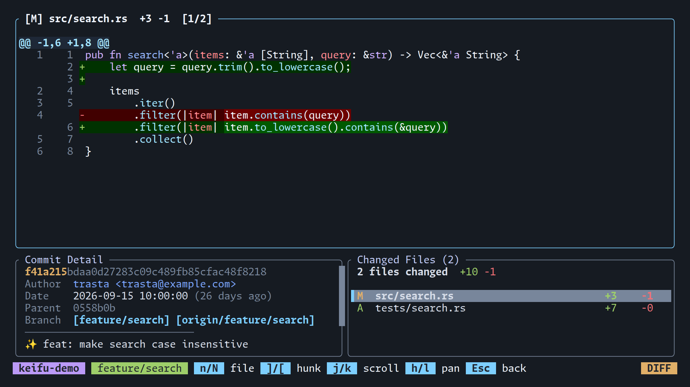
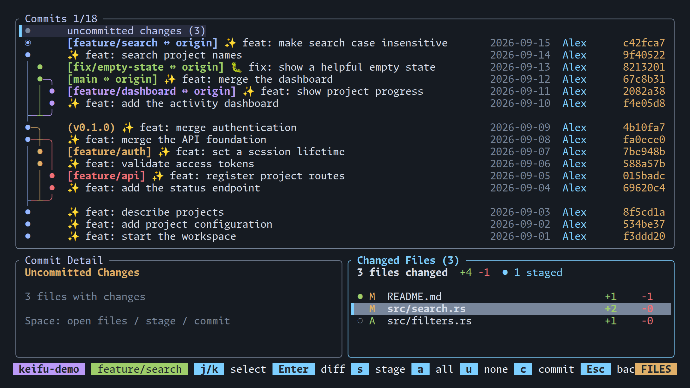
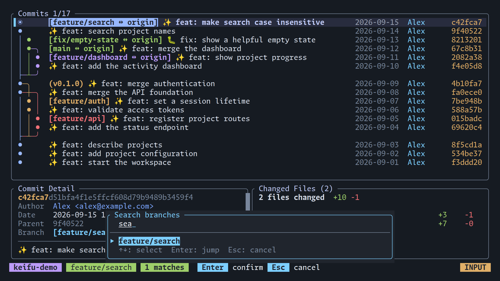
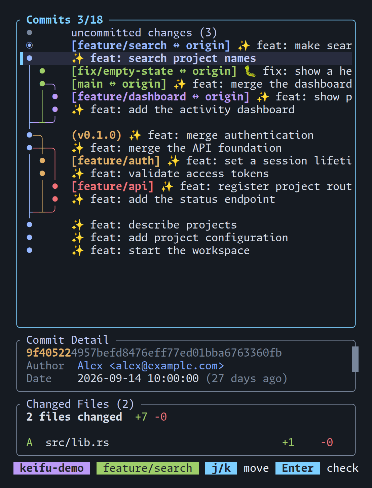

# 🧬 keifu

[](https://crates.io/crates/keifu)
[](https://ratatui.rs)

[English README](../README.md)

**ブランチの流れを見渡し、変更を確認。そのままターミナルで作業を進める。**

keifu（系譜, /keːɸɯ/）は、複数のブランチを行き来するための Git TUI です。
色分けされたコミットグラフで履歴をたどり、差分の確認からステージング・コミット・プッシュまで、
キーボードでもマウスでも操作できます。



- **ブランチの流れが見える** — 分岐とマージをグラフで確認。ローカルブランチ、リモート、タグをまとめて表示します。
- **変更を詳しく読める** — シンタックスハイライトと行内の変更強調付きでファイル差分を確認できます。
- **次の作業へ進める** — ブランチの検索・切り替えから、ファイルのステージング、コミット、origin へのプッシュまで。
- **作業環境に収まる** — ショートカット、クリック、ペインごとのスクロールに対応。狭いターミナル分割でも使え、画像プロトコルは不要です。

以下で紹介するペインを残す差分表示とドラッグでのコピーは、
v0.7.0 以降で利用できます。

## インストール

### crates.io から

```bash
cargo install keifu
```

### mise を使う

```bash
mise use -g github:trasta298/keifu@latest
```

### Homebrew を使う

```bash
brew install trasta298/tap/keifu
```

### ソースから

```bash
git clone https://github.com/trasta298/keifu
cd keifu
cargo install --path .
```

## はじめに

Git リポジトリ内（サブディレクトリも可）で起動します。

```bash
keifu
```

1. `↑` / `↓`、`j` / `k`、またはクリックでコミットを選びます。
2. `Space` で変更ファイルの選択に進み、`Enter` で差分を開きます。
3. `Esc` で戻ります。`/` でブランチ検索、`?` でヘルプを開けます。

Unicode とカラー表示に対応したターミナルが必要です。fetch / push には PATH 上の `git`、
Cargo でのインストールやソースビルドには Rust ツールチェーンが必要です。

## 画面で見る使い方

### コミットの情報と一緒に差分を読む

追加・削除された行に加え、シンタックスハイライトと行内の変更強調で差分を確認できます。
`n` / `N` でファイル間、`]` / `[` でハンク間を移動します。



差分はデフォルトでは全画面で開きます。上の画像のようにコミット詳細とファイル一覧を残すには:

```bash
keifu --file-view replace
```

### ファイルを選んでコミットする

**uncommitted changes** を選んで `Space` を押し、`s` でファイルごとにステージ／解除します。
`a` で全ファイルをステージ、`u` で全解除。`c` でコミットメッセージを入力でき、
グラフに戻って `p` を押すと現在のブランチを origin にプッシュします。



ステージングはファイル単位です。コミットにはステージ済みの変更だけが含まれます。

### 作業したいブランチを探す

`/` を押してブランチ名の一部を入力すると、ファジー検索で候補が絞られます。
`Enter` で選んだブランチの位置にジャンプし、グラフ上でもう一度 `Enter` を押すと checkout できます。



### エディタの隣にも置ける

ターミナルの幅が狭くなると詳細ペインが縦に並び、一部のコミット情報を省略して、
グラフとメッセージの表示スペースを確保します。



### マウスでも操作できる

コミットやファイルをクリックして選択し、ダブルクリックでファイル一覧や差分を開けます。
ポインタのあるペインをホイールでスクロールでき、ステータスバーの操作ヒントもクリック可能です。
ペイン内の表示中のテキストをドラッグして離すと、OSC 52 経由でコピーします
（ターミナル側のクリップボード対応が必要です）。

## 設定

`~/.config/keifu/config.toml` で初期設定を変更できます。

```toml
[ui]
file_view = "replace"
```

デフォルトでは10秒ごとにローカルの状態を更新し、60秒ごとに origin から fetch します。
自動更新の調整・無効化や、リモート・タグの表示設定は[設定ガイド](configuration_ja.md)を参照してください。

## キーバインド

アプリ内では `?` でヘルプを表示できます。

<details>
<summary>キーボード・マウス操作の一覧</summary>

### ナビゲーション

| キー | 操作 |
| --- | --- |
| `j` / `↓` | 下へ移動（詳細ペインフォーカス時はスクロール） |
| `k` / `↑` | 上へ移動（詳細ペインフォーカス時はスクロール） |
| `Tab` | ペインフォーカス切り替え（グラフ / コミット詳細） |
| `]` | ブランチラベルのある次のコミットへジャンプ |
| `[` | ブランチラベルのある前のコミットへジャンプ |
| `h` / `←` | 左のブランチを選択（同一コミット内） |
| `l` / `→` | 右のブランチを選択（同一コミット内） |
| `Ctrl+d` | ページ下へ移動 |
| `Ctrl+u` | ページ上へ移動 |
| `g` / `Home` | 先頭へ移動 |
| `G` / `End` | 末尾へ移動 |
| `@` | HEAD（現在のブランチ）へジャンプ |
| `Space` | 変更ファイル一覧を開く |

### Git 操作

| キー | 操作 |
| --- | --- |
| `Enter` | 選択中のブランチ/コミットを checkout |
| `b` | 選択中コミットからブランチを作成 |
| `d` | ブランチ削除（ローカル/非 HEAD のみ） |
| `f` | origin から fetch |
| `c` | ステージ済みの変更をコミット（メッセージ入力ダイアログ） |
| `p` | 現在のブランチを origin へ push |

### ファイル一覧（Space）/ ステージング

ステージング操作は「uncommitted changes」行を選択中のみ有効です。

| キー | 操作 |
| --- | --- |
| `j` / `k` | ファイルを選択 |
| `Enter` | ファイル差分を開く |
| `s` | 選択ファイルを stage / unstage |
| `a` | 全ての変更を stage |
| `u` | 全ての変更を unstage |
| `c` | ステージ済みの変更をコミット |
| `Esc` / `q` | 戻る |

### マウス

| 入力 | 操作 |
| --- | --- |
| コミット行をクリック | コミットを選択（ダブルクリックでファイル一覧を開く） |
| ファイル行をクリック | ファイルを選択（ダブルクリックで差分を開く） |
| ペインをクリック | ペインにフォーカス |
| ステータスバーのヒントをクリック | その操作を実行 |
| ホイールスクロール | カーソル下のペインをスクロール |
| 左ドラッグ | ペイン内の表示中のテキストを選択し、離すとコピー（OSC 52） |

クリックとダブルクリックはボタンを離したときに実行され、ドラッグでは発動しません。
選択できるのは表示中のテキストだけで、スクロールや画面の切り替えで選択は解除されます。
ターミナル標準のテキスト選択には修飾キーを使ってください
（多くのターミナルで `Shift` + ドラッグ、iTerm2 は `Fn` + ドラッグ）。

注意: Ghostty は現状、mouse-mode のアプリに対してホイール 1 ノッチを複数のスクロールイベントに増幅して送るため（[ghostty#3955](https://github.com/ghostty-org/ghostty/discussions/3955)）、1 ノッチで数行余分にスクロールすることがあります。Ghostty 設定の `mouse-scroll-multiplier` を下げると回避できます。

### 検索

| キー | 操作 |
| --- | --- |
| `/` | ブランチを検索（インクリメンタル・ファジー検索） |
| `↑` / `Ctrl+k` | 前の検索結果を選択 |
| `↓` / `Ctrl+j` | 次の検索結果を選択 |
| `Enter` | 選択したブランチへジャンプ |
| `Esc` / 空欄で `Backspace` | 検索をキャンセル |

### ファイル差分ビュー

| キー | 操作 |
| --- | --- |
| `j` / `k` / `↑` / `↓` | 上下スクロール |
| `h` / `l` / `←` / `→` | 左右スクロール |
| `Ctrl+d` / `Ctrl+u` | 半ページ下/上 |
| `Ctrl+f` / `Ctrl+b` | 1ページ下/上 |
| `g` / `G` | 先頭/末尾へ移動 |
| `0` | 行の先頭にスクロール |
| `]` / `[` | 次/前のハンクへジャンプ |
| `n` / `N` | 次/前のファイルへジャンプ |
| `Esc` / `q` | ファイル選択に戻る / 閉じる |

### その他

| キー | 操作 |
| --- | --- |
| `y` | コミットハッシュをクリップボードへコピー（OSC 52） |
| `Y` | ブランチ名をクリップボードへコピー（OSC 52） |
| `R` | リポジトリ情報を更新 |
| `o` | リモートブランチ表示を切り替え |
| `t` | タグ表示を切り替え |
| `?` | ヘルプ表示切り替え |
| `q` / `Esc` | 終了（詳細ペインフォーカス時はまずグラフへフォーカスを戻す） |

</details>

## 注意点と制限

- TUI は表示対象のブランチから最大 500 件を表示します。
- マージコミットの差分は最初の親との比較、初期コミットは空ツリーとの差分です。
- 変更ファイル一覧は 50 件までです。バイナリファイルは行数集計なしで表示されます。
- ステージ済み・未ステージ・未追跡の変更がある場合、先頭に「uncommitted changes」行が表示されます。
- 同一コミットに複数ブランチがある場合、ラベルは1つに集約され、他のブランチラベルの数が `+N` で表示されます（例: `[main ↔ origin, origin_2, origin_3 +1]`）。同名で同一コミットを指すローカルブランチとすべてのリモートブランチは1つのラベルとして数えられます。一致するリモート名は `↔` の後にアルファベット順で表示され、集約ラベルとブランチポップアップの両方で保持されます（未選択のブランチも対象）。別のコミットを指すリモートブランチや、対応するローカルブランチがないものは個別に表示されます。`h`/`l` または `←`/`→` でラベルを切り替え可能です。
- 長いブランチ名やリモート一覧は表示幅に合わせて省略されます。完全な参照名はコミット詳細で確認できます。
- `origin/xxx` を checkout すると、ローカルブランチを作成または更新します。上流の設定は新規作成時のみ行われます。ローカルブランチが別コミットを指している場合は、リモートに合わせて強制的に更新されます。
- リモートブランチはデフォルトで表示されます。`o` で非表示にすると、リモートブランチからのみ到達可能なコミットもグラフから除外されます。
- タグはデフォルトで表示されます。`t` で非表示にできます。
- 削除操作はローカルブランチのみ対応です。
- fetch / push には `origin` リモートの設定が必要です。ステージングはファイル単位のみ（hunk 単位は未対応）で、コミットには `git commit` と同様にステージ済みの変更だけが含まれます。

## 開発

ログ出力とリモート制御によるデバッグは [debugging.md](debugging.md)、
デモ用リポジトリとスクリーンショットの再作成は [screenshots/README.md](screenshots/README.md) を参照してください。

## ライセンス

MIT
